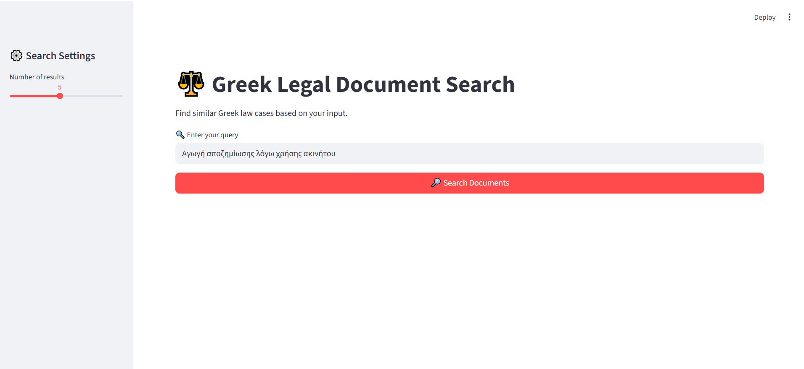
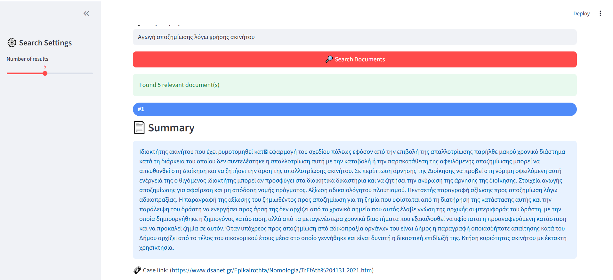
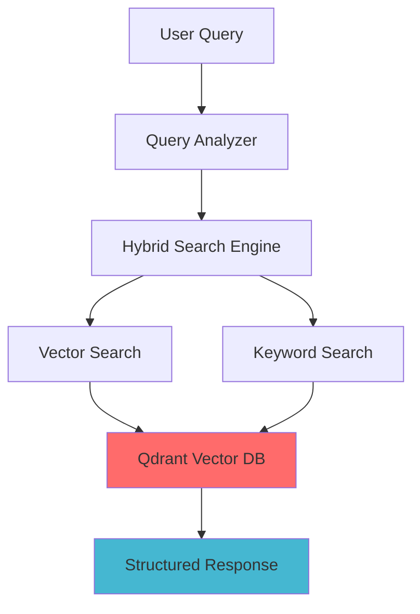

# GreekLawCase-RAG

## Problem Statement

Existing Greek case law databases are notoriously slow, outdated, and rely on rigid, exact-match keyword searches. This creates a massive inefficiency: finding semantically similar precedents takes hours of manual filtering through clunky interfaces. This not only wastes valuable time but increases the risk of missing crucial, relevant law cases.





## 💡 The Solution: A RAG-Powered Legal Vector Database

**GreekLawCase-RAG** bridges the gap between outdated Greek legal infrastructure and modern AI capabilities. By replacing traditional databases with a vector database and a RAG pipeline, it enables semantic search across thousands of Greek legal cases.
Law case data was scraped from two known public legal databases (https://www.dsanet.gr/Epikairothta/Nomologia/nomologia-latest.html and https://www.areiospagos.gr/nomologia/apofaseis.asp)


### 🚀 How It Solves the Problem?
- **⚙️ Production-Ready**: Docker containerization for enterprise-scale workloads
- **🧠 Hybrid Search**: Combines semantic vector search with keyword matching
- **📈 High Performance**: Use of optimized Qdrant configurations for high speed and accuracy

## 📋 Key Features

<table>
<tr>
<td width="50%">

### 🔍 **Advanced Search Engine**
- **Semantic Understanding**: Grasps the context of queries
- **Hybrid Search**: Combines vector similarity and keyword matching (70% vector search, 30% keyword search)
- **Configurable Weights**: Adjust vector/keyword weights per query
- **Chunk-level Results**: Retrieve relevant document sections
- **Greek Language Support**: Optimized for Greek legal terminology

### 🖥️ **Intuitive User Interface**
- **Easy to Use Search Interface**: Ability to adjust the number of results returned, provides links for law cases 
- **Real-time Search**: Sub-second response times
- **Metadata Display**: Court type, case number, year, and source links

</td>
<td width="50%">

### ⚙️ **Production Features**
- **Docker Containerization**: Easy deployment with multi-stage builds
- **Horizontal Scaling**: Optimized Qdrant architecture
- **Monitoring & Logging**: Built-in observability to track system health and search latency
- **Health Checks**: Comprehensive component health monitoring
- **CORS Support**: Ready for frontend integration

### 📊 **Analytics & Insights**
- **Performance Monitoring**: Real-time metrics dashboard
- **A/B Testing**: Compare different hybrid search weights
- **Prometheus Metrics**: Exportable metrics for monitoring

</td>
</tr>
</table>

## 🏗️ System Architecture

<div align="center">



</div>

### 🔧 Backend Architecture

The system is built on a **modular, scalable architecture** with clear separation of concerns:

#### **Core Components**

| Component | Description | Technology |
|-----------|-------------|------------|
| **API Layer** | FastAPI-based REST API with async support | FastAPI, Uvicorn, Starlette |
| **Search Engine** | Hybrid search combining vector + keyword | Custom HybridSearchEngine |
| **Vector Database** | High-performance vector storage & retrieval | Qdrant v1.7+ |
| **Embedding Service** | Text-to-vector conversion with batching | OpenAI text-embedding-3-small |
| **Document Store** | Document ingestion, chunking, and storage | Custom DocumentStore |
| **Configuration** | Environment-based settings with validation | Pydantic Settings |

#### **API Endpoints**

| Endpoint | Method | Description |
|----------|--------|-------------|
| `/api/v1/search` | POST | Main hybrid search endpoint |
| `/api/v1/search` | GET | Search with query parameters |
| `/api/v1/health` | GET | Health check for all components |
| `/api/v1/metrics` | GET | Prometheus-compatible metrics |
| `/api/v1/stats` | GET | Detailed service statistics |
| `/docs` | GET | Interactive API documentation (Swagger) |
| `/redoc` | GET | Alternative API documentation |

#### **Search Pipeline**

1. **Query Analysis** - Input validation and preprocessing
2. **Vector Search** - Semantic similarity via Qdrant HNSW index
3. **Keyword Search** - BM25-style full-text matching
4. **Score Fusion** - Weighted combination (default 70/30)
5. **Result Ranking** - Sort by combined score
6. **Response Formatting** - Structured JSON with metadata

#### **Data Models**

- **SearchRequest** - Query, weights, limits, filters
- **SearchResponse** - Results with scores, timing, metadata
- **SearchResultItem** - Individual result with vector/keyword/combined scores
- **HealthResponse** - Component health status
- **MetricsResponse** - Performance counters and gauges

## 🚧 Challenges and Solutions

Building a RAG system for a highly specific and complex domain like Greek jurisprudence comes with unique technical hurdles. While the current version solves the core search problem, the following challenges are the primary focus for the next iterations of this project:

### 1. 📈 Scaling Vector Search for Massive Datasets
* **The Challenge:** As the database ingests decades of Greek case law, performing high-dimensional vector searches at scale will increase latency and memory consumption.
* **The Solution:** 
  * Implement **quantization** (scalar and product) in Qdrant to significantly reduce the memory footprint of vectors without sacrificing recall.
  * Fine-tune **Qdrant HNSW index settings** (e.g., `m`, `ef_construct`).
  * Introduce a **Redis-based caching layer** to instantly intercept and serve frequent or repetitive legal queries.

### 2. 🧩 Optimizing the Chunking Strategy
* **The Challenge:** Greek legal documents have highly nested and rigid structures (Laws -> Articles -> Paragraphs -> Sub-paragraphs). Standard recursive text splitting often breaks these semantic boundaries, losing crucial context.
* **The Solution:** 
  * Build an automated evaluation pipeline to perform **A/B testing** across various chunking techniques.
  * Experiment with **Semantic Chunking** and **Document-Structure-Aware Parsing** (using regex or ASTs to respect the hierarchy of legal articles) to ensure chunks retain their complete legal meaning.

### 3. 🧠 Advanced Data Processing & Entity Extraction
* **The Challenge:** Currently, the system relies on raw text embeddings. It lacks a structured understanding of the specific legal entities mentioned within the texts.
* **The Solution:** 
  * Integrate advanced **NLP techniques (specifically Named Entity Recognition - NER)** tailored for the Greek language.
  * Automatically extract and tag specific entities such as **cited legislation** (e.g., *Ν. 4139/2013*), **legal terminology**, **penalty types**, and **dates**.
  * Use these extracted entities to enable **metadata filtering** (e.g., "Find cases similar to X, but *only* if they cite Law Y").

## 🛠️ Tech Stack

### Core Technologies
- **Python 3.11+** - Primary language
- **FastAPI** - High-performance async web framework
- **Qdrant** - Vector database with HNSW indexing
- **OpenAI** - Embeddings (text-embedding-3-small) & LLMs
- **Streamlit** - Interactive frontend
- **Docker** - Containerization

### Supporting Libraries
- **Pydantic** - Data validation & settings management
- **httpx** - Async HTTP client
- **structlog** - Structured logging
- **prometheus-client** - Metrics exposition
- **pytest/pytest-asyncio** - Testing framework
- **ragas** - RAG evaluation metrics
- **instructor** - Structured LLM outputs

### Prerequisites
- Docker & Docker Compose
- OpenAI API Key

## 🚀 Getting Started

### 🐳 Docker Deployment (Recommended)

```bash
# 1️⃣ Clone the repository
git clone https://github.com/thanos-pal/Greek_Law_Case_RAG.git
cd Greek_Law_Case_RAG

# 2️⃣ Set up environment
cp .env.example .env
# Put your OpenAI API key inside .env file

# 3️⃣ Start all services (Qdrant + API + Streamlit)
docker compose up -d

# 4️⃣ Initialize database and ingest sample documents
docker compose --profile setup run --rm setup-db
docker compose --profile setup run --rm ingest

# 5️⃣ Access the application
# Streamlit UI: http://localhost:8501
# API docs: http://localhost:8000/docs
```

### 🔧 Development Mode

```bash
# Start with hot reload for API development
docker compose --profile dev up -d

# API will be available at http://localhost:8000 with auto-reload
# Streamlit available at http://localhost:8501
```

### 💻 Local Development (Without Docker)

```bash
# 1️⃣ Clone the repository
git clone https://github.com/thanos-pal/Greek_Law_Case_RAG.git
cd Greek_Law_Case_RAG

# 2️⃣ Set up environment
cp .env.example .env
# Put your OpenAI API key inside .env file

# 3️⃣ Start Qdrant only
docker compose up -d qdrant

# 4️⃣ Install dependencies
pip install -r requirements.txt

# 5️⃣ Initialize system
python scripts/setup_database.py
python scripts/ingest_documents.py --create-sample

# 6️⃣ Start API (in one terminal)
python -m uvicorn api.main:app --host 0.0.0.0 --port 8000 --reload

# 7️⃣ Start Streamlit (in another terminal)
streamlit run app.py
```

### 🧪 Running Tests

```bash
# Run unit/integration tests
docker compose --profile test run --rm test

# Run integration tests against running API
docker compose --profile test run --rm integration-test
```

## 📁 Project Structure

```
Greek_Law_Case_RAG/
├── api/                    # FastAPI backend
│   ├── main.py            # Application entry point
│   ├── routes/            # API route handlers
│   ├── services/          # Business logic services
│   ├── schemas/           # Pydantic models
│   ├── middleware/        # Custom middleware
│   └── utils/             # Utility functions
├── core/                   # Core business logic
│   ├── config/            # Configuration management
│   ├── database/          # Database clients & managers
│   ├── models/            # Domain models
│   └── services/          # Core services (embedding, search)
├── scripts/                # Utility scripts
│   ├── setup_database.py  # Qdrant collection setup
│   └── ingest_documents.py # Document ingestion pipeline
├── tests/                  # Test suite
│   ├── test_api.py        # Integration tests for API
│   ├── test_embedding.py  # Embedding analysis & visualization
│   ├── test_performance.py # Performance benchmarking
│   └── ragas_evaluation.py # RAGAS retrieval evaluation
├── data/                   # Data files (gitignored)
│   ├── raw/               # Raw scraped data
│   └── processed/         # Processed outputs
├── memory/                 # Project documentation
├── Dockerfile             # Multi-stage Docker build
├── docker_compose.yml     # Service orchestration
├── requirements.txt       # Python dependencies
├── pytest.ini            # Pytest configuration
├── pyproject.toml        # Tool configuration
├── app.py                # Streamlit frontend
├── .env.example          # Environment template
└── README.md             # This file
```

## 📊 RAG Evaluation with RAGAS

The project includes a comprehensive **RAGAS evaluation framework** to measure retrieval quality:

### Metrics Evaluated
- **Context Precision** - How many of the retrieved contexts are relevant
- **Context Recall** - How many of the relevant contexts were retrieved  
- **Context Relevance** - How relevant the retrieved contexts are to the query

### Usage

```bash
# Create evaluation template
python tests/ragas_evaluation.py --create-template data/eval_dataset.json

# Edit the template with your ground truth cases
# Format: "case_number/year" (e.g., "76/2015")

# Run evaluation
python tests/ragas_evaluation.py --dataset data/eval_dataset.json --top-k 5

# Results saved to data/processed/ragas_evaluation_results.json
```

### Evaluation Dataset Format
```json
[
  {
    "query": "Αίτηση αναίρεσης κατά απόφασης ειρηνοδικείου/πρωτοδικείου",
    "relevant_cases": ["1338/2015", "1030/2014", "1431/2014"],
    "expected_top_k": 5
  }
]
```

## 🧪 Testing Strategy

The project includes **multiple test layers** ensuring production readiness:

### 1. Unit & Integration Tests (`tests/test_api.py`)
- **Health Endpoint** - Component connectivity verification
- **Search Endpoint** - POST/GET with various parameters
- **Validation** - Weight sum validation, empty query handling
- **Metrics & Stats** - Observability endpoint verification
- **CORS** - Cross-origin request handling
- **Error Handling** - Proper HTTP status codes & error format

### 2. Embedding Analysis (`tests/test_embedding.py`)
- **Vector Statistics** - Norms, distributions, similarity matrices
- **Visualization** - Embedding space exploration
- **Performance** - Processing time vs token count
- **Export** - JSON statistics for tracking

### 3. Performance Benchmarking (`tests/test_performance.py`)
- **Configuration Comparison** - Vector/keyword weight A/B testing
- **Search Latency** - Response time measurement
- **Score Analysis** - Result quality across configurations
- **Recommendations** - Automated optimization suggestions

### 4. RAGAS Evaluation (`tests/ragas_evaluation.py`)
- **Retrieval Quality** - Precision, recall, relevance metrics
- **Ground Truth** - Case-number-based evaluation
- **Automated Reporting** - JSON results with timestamps

### Test Execution in CI/CD
```bash
# All tests run in Docker for consistency
docker compose --profile test run --rm test

# Integration tests require running services
docker compose --profile test run --rm integration-test
```

## 🔍 Monitoring & Observability

### Health Checks
- **Qdrant** - Connection & collection status
- **Embeddings** - API connectivity & response time
- **Overall** - Aggregated service health

### Metrics (Prometheus-compatible)
- `total_searches` - Request counter
- `avg_search_time_ms` - Latency gauge
- `cache_hits/misses` - Embedding cache efficiency
- `active_connections` - Current load
- `uptime_seconds` - Service availability

### Logging
- **Structured JSON** - Machine-parseable logs
- **Request ID** - Distributed tracing
- **Log Levels** - DEBUG/INFO/WARNING/ERROR
- **Middleware** - Automatic request/response logging

## 🐳 Docker Architecture

### Multi-Stage Build
```dockerfile
# Base stage - shared dependencies
FROM python:3.11-slim as base

# Development - hot reload
FROM base as development

# Production API
FROM base as api

# Streamlit Frontend
FROM base as streamlit

# Test Runner
FROM base as test
```

### Services (docker-compose.yml)
| Service | Profile | Purpose |
|---------|---------|---------|
| `qdrant` | default | Vector database |
| `api` | default | FastAPI backend |
| `streamlit` | default | Streamlit frontend |
| `api-dev` | dev | Development API with reload |
| `test` | test | Unit/integration tests |
| `integration-test` | test | API integration tests |
| `setup-db` | setup | Database initialization |
| `ingest` | setup | Document ingestion |

## 🔐 Security Considerations

- **Non-root User** - Containers run as `appuser`
- **Environment Variables** - Secrets via `.env` (not in image)
- **CORS Configuration** - Restrict origins in production
- **API Keys** - Qdrant API key support
- **Network Isolation** - Dedicated Docker network

## 📈 Performance Optimization

### Qdrant Configuration
- **HNSW Index** - `m=16`, `ef_construct=100`
- **Distance Metric** - Cosine similarity
- **Payload Indexes** - Court type, case number, year, dates

### Embedding Optimization
- **Batch Processing** - 100 documents per batch
- **Chunking** - 8192 tokens with 200 overlap
- **Caching** - In-memory embedding cache

### Search Tuning
- **Default Weights** - 70% vector / 30% keyword
- **Min Score** - 0.3 threshold
- **Result Limit** - Max 50 per query

## 🤝 Contributing

1. Fork the repository
2. Create a feature branch
3. Add tests for new functionality
4. Ensure all tests pass: `docker compose --profile test run --rm test`
5. Submit a pull request

## 📄 License

MIT License - see LICENSE file for details

## 🙏 Acknowledgments

- **Qdrant** - Vector database
- **OpenAI** - Embeddings & LLM APIs
- **RAGAS** - Evaluation framework
- **FastAPI** - Web framework
- **Streamlit** - Frontend framework